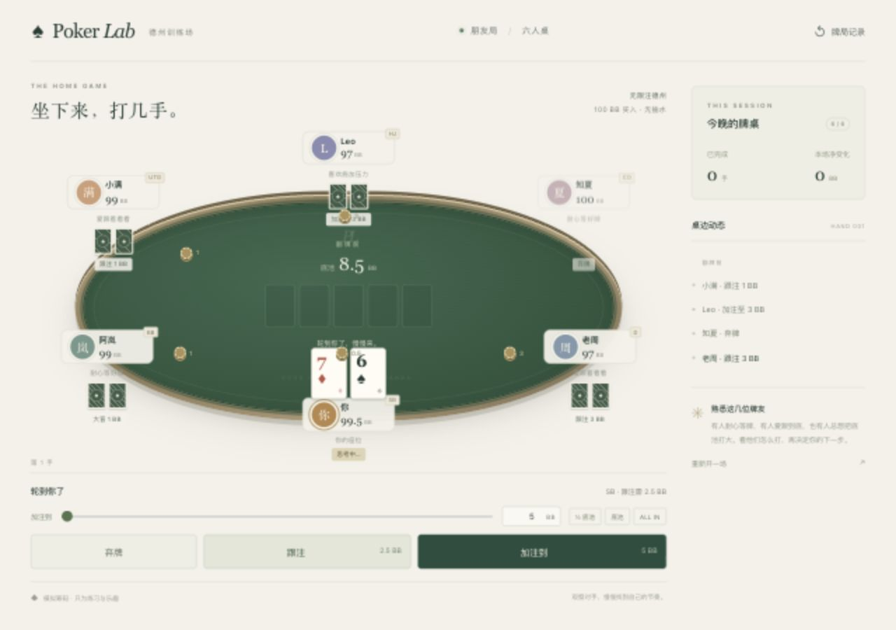

# Poker Lab · 德州训练场

A quiet, friendly six-seat hold'em table with opponents whose habits affect how they play.

The first local playable version uses 100 BB starting stacks, 0.5/1 BB blinds, no rake, five fictional opponents, and post-hand replay. Stakes are simulated. PokerKit 0.7.4 handles legal actions and settlement; a small Python server serves the table. No API keys, model calls, Node installation or frontend build are needed.



## Play locally

Requires Python 3.11 or newer. From this project directory:

```sh
python3 -m venv .venv
.venv/bin/python -m pip install -r requirements.txt
.venv/bin/python -m poker_lab.server
```

Open <http://127.0.0.1:8765>. On macOS, `start.command` also starts the table (and installs the requirement on its first run if the virtual environment is absent). Keep its terminal running while playing; Ctrl-C stops it. Use `--port 8766` if the default port is in use.

Play a hand, review it after settlement, then deal the next one. All raise amounts are **the total committed on the current street**, displayed in BB. The dealer moves each hand; stacks carry forward. A stack below 1 BB is replenished to 100 BB before the next hand, with a table notice. Session profit excludes these replenishments.

## The five regulars

- 阿岚 and 知夏 are selective and aggressive, with greater respect for price and public aggression.
- 小满 and 老周 enter more pots, prefer calling, and become attached to top pair.
- Leo applies pressure, bluffs more, and tends to overestimate his hand.

These are deliberately imperfect heuristic policies, not GTO agents. Postflop decisions use a small Monte Carlo estimate against random holdings, together with position, pot odds, draw features and style biases. This is a rough internal signal, not a claim about optimal action value.

The bots also learn how each player at the table plays, using only public actions and cards shown at showdown: how often someone enters pots, raises, folds to a bet, bets aggressively, and how often a river bet turned out to be a bluff. Each estimate starts from a population prior and firms up with evidence, so a few hands barely move it. Against a player who folds too much they bluff more and value-bet less thinly; against one who calls everything they bluff less and bet bigger; against a shown bluffer they call more lightly. 阿岚 and 知夏 adapt quickly, Leo more slowly, and 小满 and 老周 hardly at all. A new table starts with no reads.

## Replay and information boundaries

The browser receives your hole cards and legitimately revealed opponent cards. Bots receive their own cards plus public observations through a separate contract. Neither receives the full deck or other hidden cards. Replay frames preserve what was visible at each point; later showdown information is not backfilled into earlier frames.

The latest 100 completed hands are available while the local server is running. Refreshing the browser resumes its session; restarting the server clears sessions and history. Replay includes a pot-odds observation where applicable, but does not grade decisions by their outcome. Long-term opponent learning and temporary moods remain future work.

## Verify

```sh
.venv/bin/python -m unittest discover -s tests -v
```

Tests cover the adapter's legal-action boundaries, short all-ins, side pots, replay visibility, deterministic dealing and chip accounting, plus conditional differences between opponent policies. Card dealing and each bot use separate random streams.

## Project notes

- [Working instructions](AGENTS.md)
- [Product brief](docs/PROJECT_BRIEF.md)
- [Roadmap](docs/ROADMAP.md)
- [Architecture](docs/ARCHITECTURE.md)
- [Working with Codex and Claude Code](docs/COLLABORATION.md)
- [PokerKit](https://github.com/uoftcprg/pokerkit), MIT-licensed rules engine ([documentation](https://pokerkit.readthedocs.io/en/stable/))

Private owner context stays in `.private/` and is excluded from Git and the server's static file allowlist. The project currently runs locally and has no public deployment.
